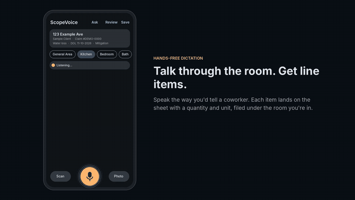
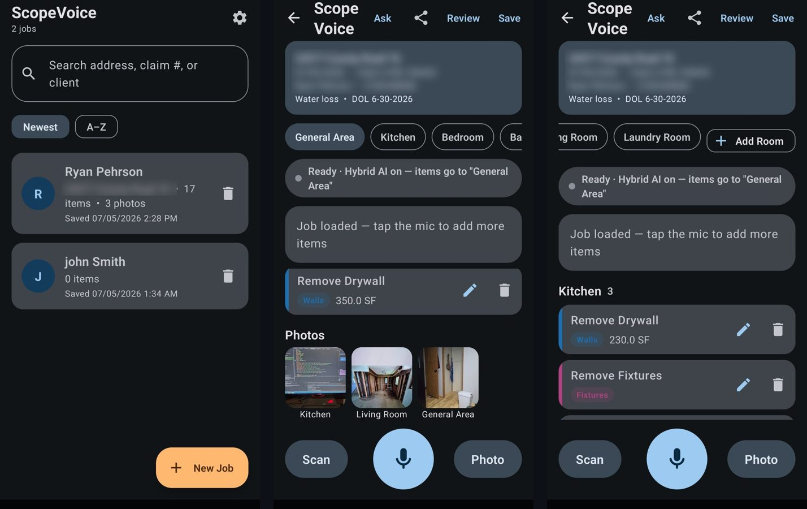
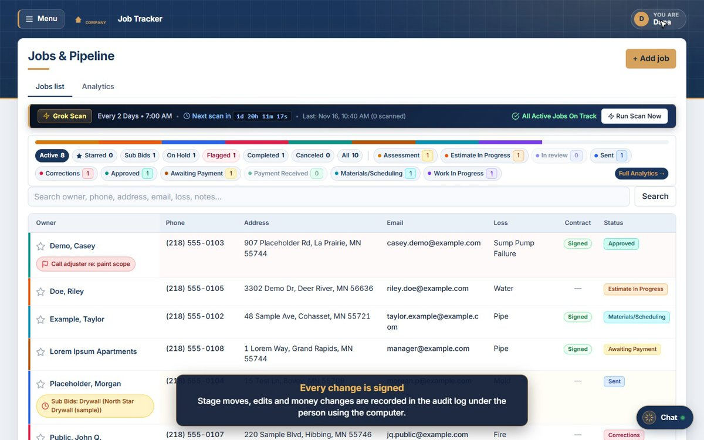
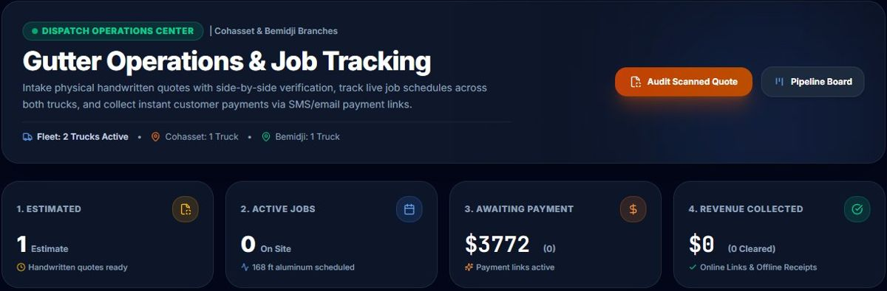
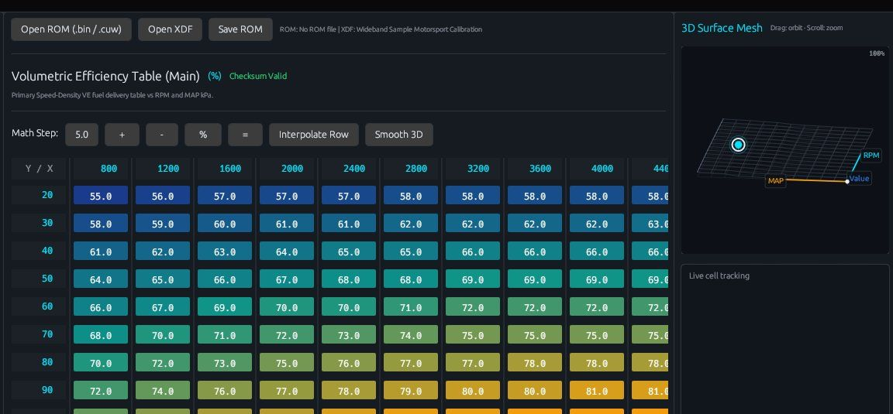
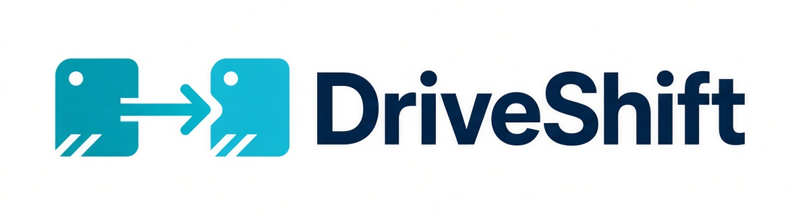
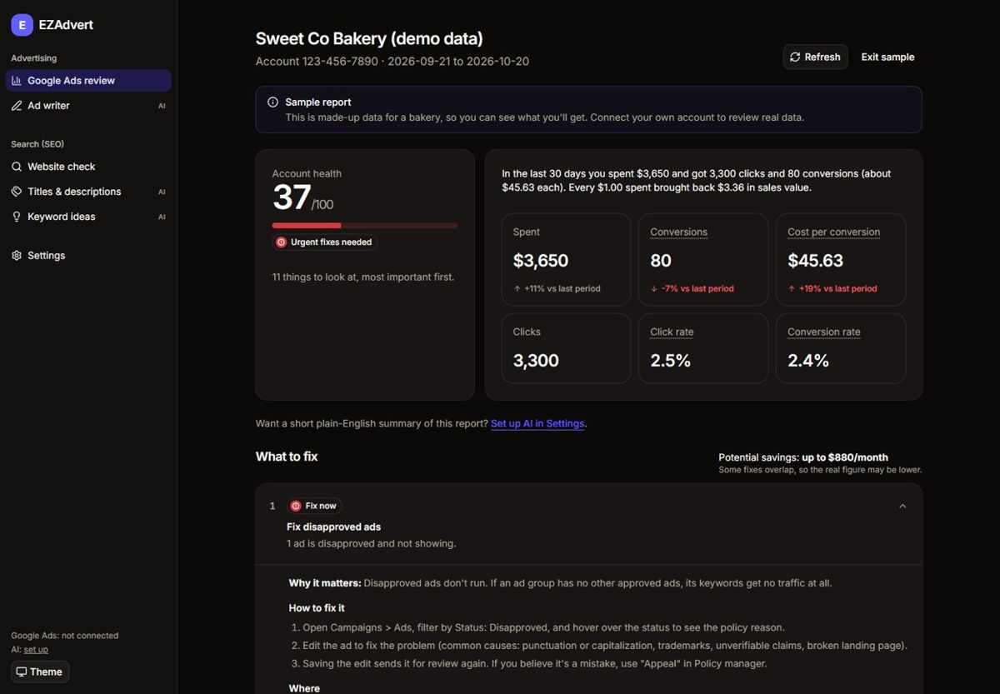
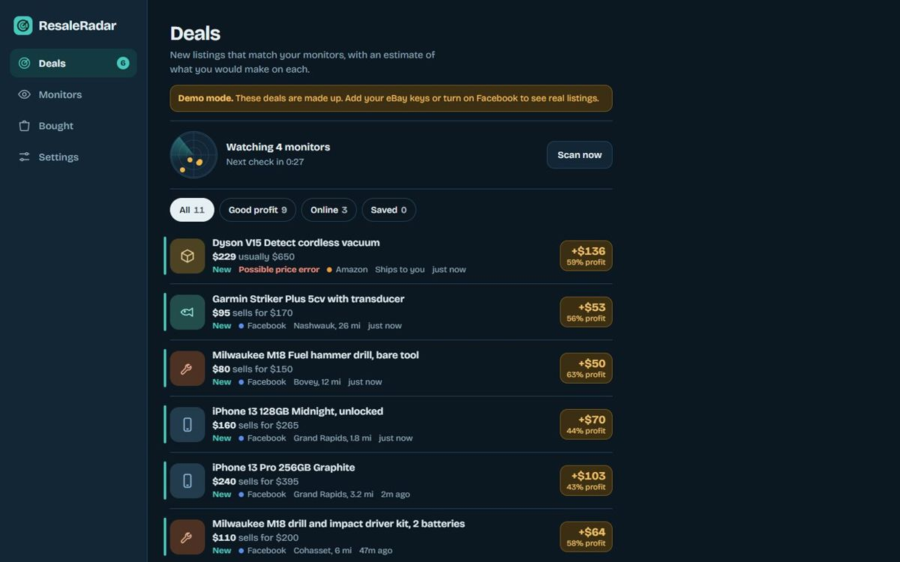
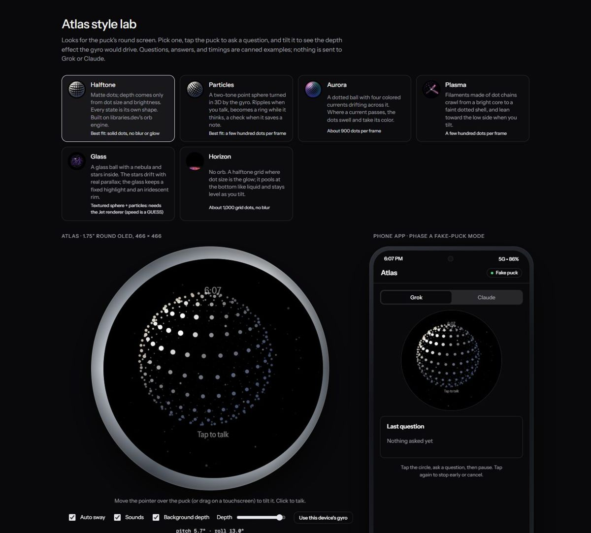
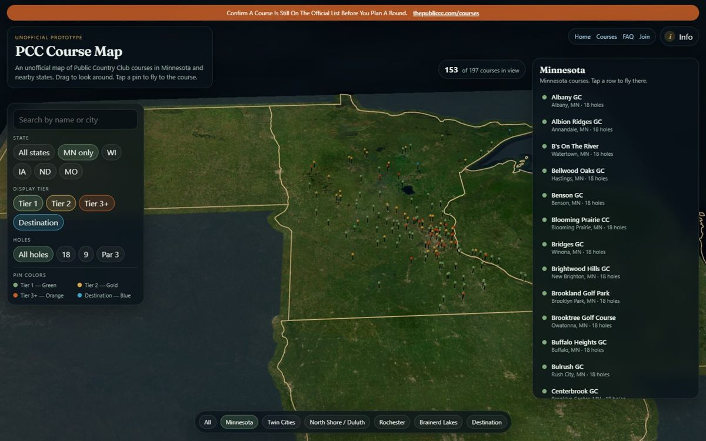

## Ryan Pehrson

Rebuild Manager at SERVPRO in northern Minnesota. I write Xactimate scopes and run reconstruction on fire, water and storm losses, and I build the software my crews and office use.

Most of my repositories are private because working businesses use them. Below is what is in them, with screenshots of each app running. Customer details in the screenshots are placeholders or blurred.

**Stack:** Kotlin/Android · C#/ASP.NET Core · TypeScript/React · Python · Rust · SQLite · Supabase/Postgres 
**Daily tools:** Claude Code · Cursor · Codex · OpenCode

---

### Built for the job site

**ScopeVoice** · Kotlin, Android, Grok 
An estimator walks the loss and talks. Speech becomes estimate line items, filed by room, with rules that keep mitigation and rebuild scopes apart.

▶ [Watch the 84-second walkthrough](https://ryanpeh139.github.io/ryanpeh139/scopevoice-demo.html) (animated, sample data) · real app screens below

**Job Tracker** · C#, ASP.NET Core, SQLite 
Self-hosted office system for a restoration contractor: 11-stage job pipeline, sub bids, purchase orders, cost schedules and a rebuild burn sheet that fills itself. AI drafts need a person's approval before anything is saved.

**GutterFlow** · React, Supabase, Stripe · in production 
Started as a tool I used while managing installs for a gutter company; now runs two of them. Photograph a handwritten quote and it becomes a job, then dispatch, invoicing and payment links.

---

### Other projects

**Wideband Motorsport Studio** · Rust, egui 
Desktop tool that reads, edits and flashes engine computers over J2534, with its own ISO-TP/UDS stack and a virtual ECU for testing without a truck.

**DriveShift** · Rust, GPUI · open source (MIT) 
Windows app that moves installed programs, Steam/Epic games and user data to another drive without reinstalling. It copies, verifies, then leaves a junction at the old path so shortcuts, updates and uninstallers keep working, with automatic undo if anything fails.

**R50 → Infinite Tees** · PowerShell, Python, MediaPipe 
Connects a Garmin Approach R50 launch monitor to the Infinite Tees golf sim from one desktop icon, then adds a spoken AI coach. It knows the club, each player's usual numbers and, through a face-on webcam with pose tracking, what their swing did differently on a bad shot.

<table>
<tr>
<td width="50%"><b>Adsight</b> (formerly EZAdvert) · TypeScript Plain-English SEO audits, read-only Google Ads reviews and AI-written ads for small businesses. </td>
<td width="50%"><b>ResaleRadar</b> · Python Finds underpriced local listings, estimates resale profit and sends alerts. </td>
</tr>
<tr>
<td><b>Atlas</b> · Kotlin, ESP32-S3 A round desk voice assistant you tap and talk to, with an Android companion app. </td>
<td><b>PCC Course Map</b> · TypeScript Interactive 3D map of 197 golf courses. <a href="https://pccweb-flax.vercel.app">Live</a> </td>
</tr>
</table>

Also: **Country Trail**, a browser game in the spirit of The Oregon Trail ([play it](https://country-trail.vercel.app)) · **Quarry**, an Android price tracker · **Quartermaster Elite**, an encrypted offline inventory app · **ATAK-CX**, one-script setup for private team-mapping servers.

---

Open to roles that put technical work alongside field and project teams in construction technology. Reach me at ryanpeh139@gmail.com.
